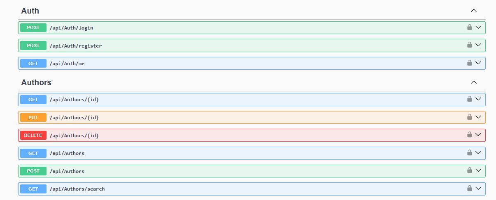
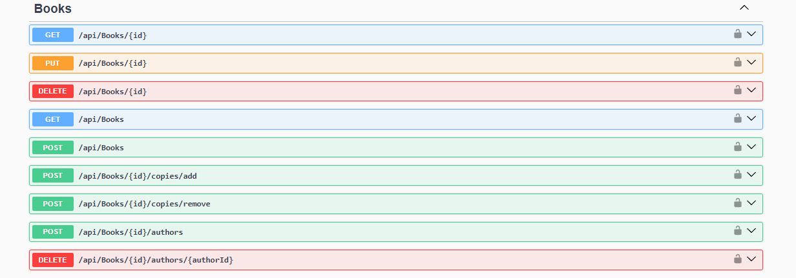
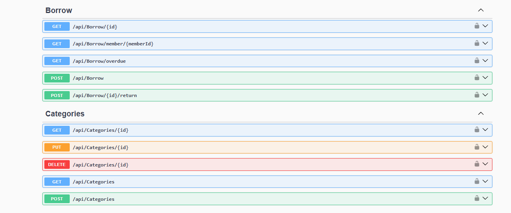
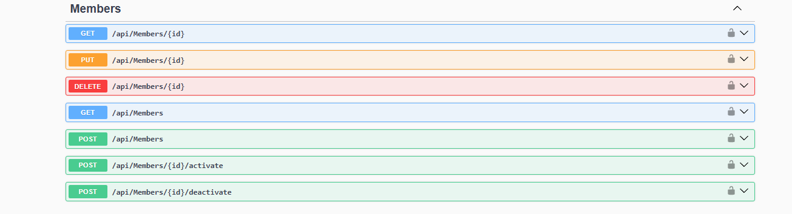
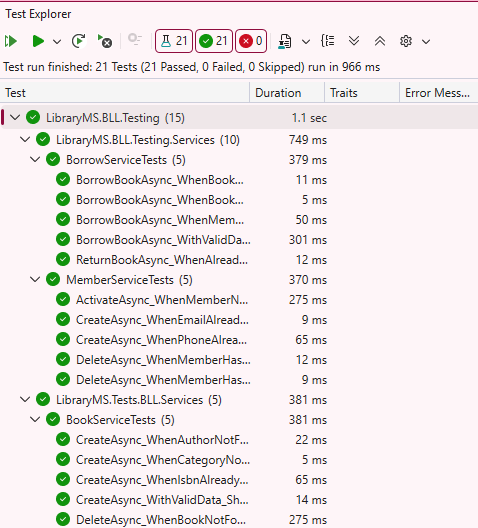
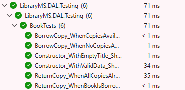

# 📚 Library Management System API

A **Library Management System** built with **ASP.NET Core Web API** following a **3-Tier Clean Architecture**.

Built as a training project to practice production-style backend design: Rich Domain Models, Repository + Unit of Work, JWT authentication with role-based authorization, validation, global exception handling, and unit testing.


---

## 🖼️ Preview

### API Documentation (Swagger)

**Auth & Authors**



**Books**



**Borrow & Categories**



**Members**



### Unit Tests





---

## ✨ Features

- Manage **books, authors, categories, and members**
- **Borrow and return** books with automatic inventory tracking (available copies)
- **Overdue detection** and automatic **fine calculation**
- **JWT authentication** with two roles: `Admin` and `Librarian`
- **Soft delete** and a full **audit trail** (who created/updated/deleted, and when)
- Search with filtering and pagination
- Consistent error responses via a global exception middleware
- Interactive API docs with **Swagger** (with JWT "Authorize" support)

---

## 🏗️ Architecture

```
LibraryMS.sln
│
├── LibraryMS.DAL     → Data Access Layer (Entities, EF Core, Repositories, Unit of Work)
├── LibraryMS.BLL     → Business Logic Layer (Services, DTOs, AutoMapper, Validators, JWT)
├── LibraryMS.PL      → Presentation Layer (Controllers, Middleware, Program.cs)
└── LibraryMS.Tests   → Unit tests (xUnit, Moq, FluentAssertions)
```

**Dependency direction:** `PL → BLL → DAL`. Controllers only talk to services (never to repositories or entities directly).

### Key design decisions

- **Rich Domain Model**: entities encapsulate their own rules through private setters and domain methods (e.g. `Book.BorrowCopy()`, `Member.Deactivate()`), so an entity can never reach an invalid state.
- **Repository + Unit of Work**: a generic repository removes CRUD duplication; the Unit of Work saves multi-entity operations (like borrowing a book) in a single transaction.
- **DTOs at the boundary**: entities are never exposed through the API. Entity → DTO mapping uses AutoMapper; DTO → Entity goes through constructors/domain methods.
- **Soft delete + audit fields** via a shared `BaseEntity` and a global EF Core query filter.
- **Custom exceptions** (`NotFoundException`, `BusinessRuleException`) translated to HTTP status codes by `GlobalExceptionMiddleware`.
- **Separation of identities**: `ApplicationUser` (staff who log in) is separate from `Member` (library patrons who borrow books).

---

## 🚀 Tech Stack

| Area | Technology |
| --- | --- |
| Framework | ASP.NET Core Web API |
| ORM | Entity Framework Core (Code-First, Migrations) |
| Database | SQL Server |
| Auth | ASP.NET Core Identity + JWT Bearer |
| Mapping | AutoMapper |
| Validation | FluentValidation |
| Docs | Swagger (Swashbuckle) |
| Testing | xUnit, Moq, FluentAssertions |

---

## 🧩 Domain Model

| Entity | Description |
| --- | --- |
| **Book** | Title, ISBN, year, total/available copies. Many-to-many with Author, belongs to one Category. |
| **Author** | Name and bio. |
| **Category** | Book classification. |
| **Member** | Library patron who borrows books (no login). |
| **BorrowRecord** | Full borrow → return lifecycle, due date, and fine. |
| **ApplicationUser** | Staff account (Identity) with `Admin` or `Librarian` role. |

---

## 🔐 Authentication & Roles

| Role | Permissions |
| --- | --- |
| **Admin** | Everything, including deleting records and registering new staff |
| **Librarian** | Day-to-day operations: books, members, borrowing and returning |

- `POST /api/auth/login` is public.
- `POST /api/auth/register` is **Admin only** (creates staff accounts).
- `GET /api/auth/me` returns the currently authenticated user.
- Browsing books, authors, and categories (GET) is public.
- On first run, the roles and a default Admin account are **seeded automatically**.

---

## 📡 API Overview

| Resource | Route | Highlights |
| --- | --- | --- |
| Auth | `/api/auth` | login, register, me |
| Books | `/api/books` | CRUD, search/filter/pagination, add/remove copies, link/unlink authors |
| Authors | `/api/authors` | CRUD, search by name |
| Categories | `/api/categories` | CRUD |
| Members | `/api/members` | CRUD, activate/deactivate |
| Borrow | `/api/borrow` | borrow, return, by member, overdue |

Full interactive documentation is available at `/swagger` when the API is running.

### Business rules enforced

- A book cannot be borrowed when no copies are available
- Inactive members cannot borrow; members with overdue books cannot borrow
- A borrow record cannot be returned twice
- Late returns automatically get a fine (per day of delay)
- Duplicate ISBN / email / phone / category name are rejected
- Authors, categories, and members linked to active data cannot be deleted

---

## ⚙️ Getting Started

### Prerequisites

- [.NET SDK](https://dotnet.microsoft.com/download) (the version used by the project)
- SQL Server (LocalDB, Express, or full)
- Visual Studio 2022 or VS Code

### 1. Clone

```bash
git clone https://github.com/<your-username>/library-management-system-api.git
cd library-management-system-api
```

### 2. Create your local settings file

`appsettings.json` is intentionally **not committed** (it contains secrets). Copy the template and fill in your own values:

```bash
cp LibraryMS.PL/appsettings.example.json LibraryMS.PL/appsettings.json
```

Windows PowerShell:

```powershell
Copy-Item LibraryMS.PL\appsettings.example.json LibraryMS.PL\appsettings.json
```

Then edit `LibraryMS.PL/appsettings.json`:

```json
{
  "ConnectionStrings": {
    "DefaultConnection": "Server=.;Database=LibraryMS;Trusted_Connection=True;TrustServerCertificate=True"
  },
  "JwtSettings": {
    "SecretKey": "YOUR_OWN_SECRET_KEY_AT_LEAST_32_CHARACTERS_LONG",
    "Issuer": "LibraryMS.API",
    "Audience": "LibraryMS.Client",
    "ExpiryMinutes": 60
  },
  "SeedAdmin": {
    "Email": "admin@library.com",
    "Password": "choose-a-strong-password",
    "FullName": "System Administrator"
  }
}
```

> 💡 For a safer setup, use **User Secrets** instead of editing the file:
>
> ```bash
> cd LibraryMS.PL
> dotnet user-secrets init
> dotnet user-secrets set "JwtSettings:SecretKey" "your-secret-key"
> dotnet user-secrets set "SeedAdmin:Password" "your-admin-password"
> ```

### 3. Apply database migrations

Package Manager Console:

```powershell
Update-Database -Project LibraryMS.DAL -StartupProject LibraryMS.PL
```

Or with the .NET CLI (requires `dotnet-ef`):

```bash
dotnet ef database update --project LibraryMS.DAL --startup-project LibraryMS.PL
```

### 4. Run the API

```bash
dotnet run --project LibraryMS.PL
```

Open `https://localhost:<port>/swagger`.

### 5. Try it in Swagger

1. `POST /api/auth/login` with the seeded Admin credentials
2. Copy the returned `token`
3. Click **Authorize** and paste the token
4. Call any protected endpoint

> If the browser blocks the HTTPS connection, trust the local dev certificate once:
>
> ```bash
> dotnet dev-certs https --trust
> ```

---

## 🧪 Running the Tests

```bash
dotnet test
```

The test suite covers:

- **Domain logic**: entity invariants tested in isolation (e.g. `Book.BorrowCopy()` throws when no copies are available), no mocking required.
- **Service logic**: business rules and orchestration tested with Moq (e.g. borrowing decrements copies and saves once; duplicate ISBN is rejected).

---

## 📌 Roadmap

- Frontend (HTML/CSS/JavaScript + Bootstrap) consuming this API *(coming soon)*
- Refresh tokens and token revocation
- Rate limiting on auth endpoints
- Pagination metadata (total count/pages) in list responses
- Docker support for the API and database
- CI pipeline running `dotnet test` on every push

---

## 📄 License

This project is licensed under the [MIT License](LICENSE).
